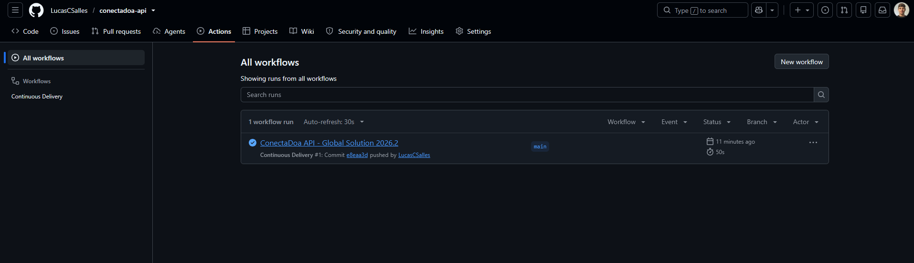
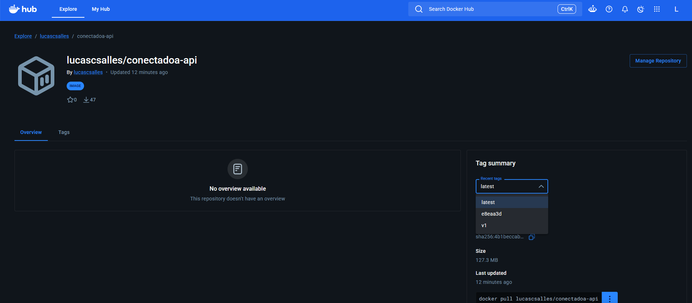
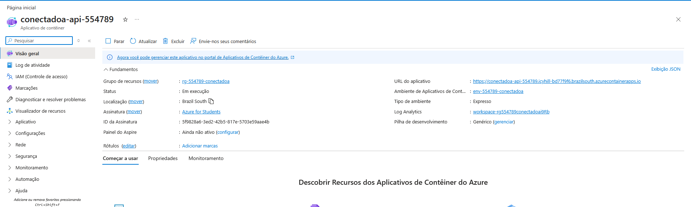
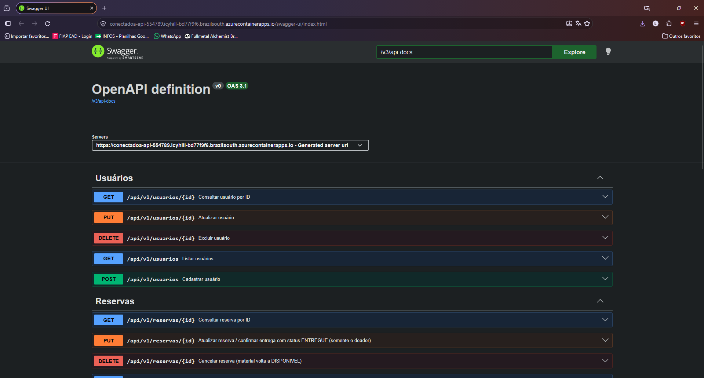
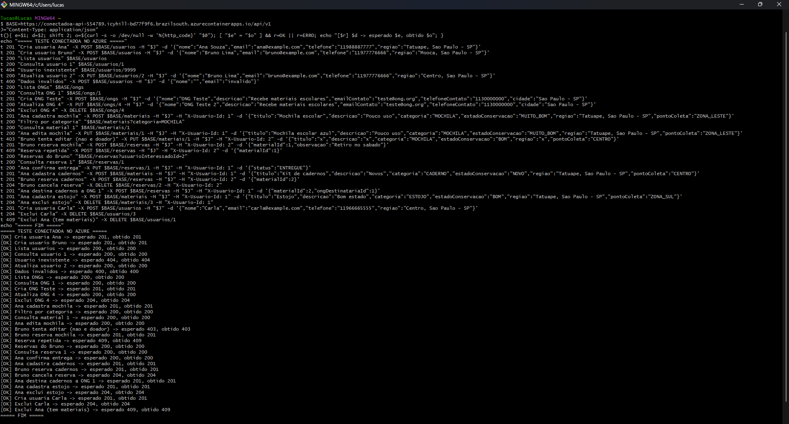
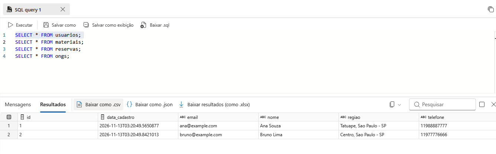
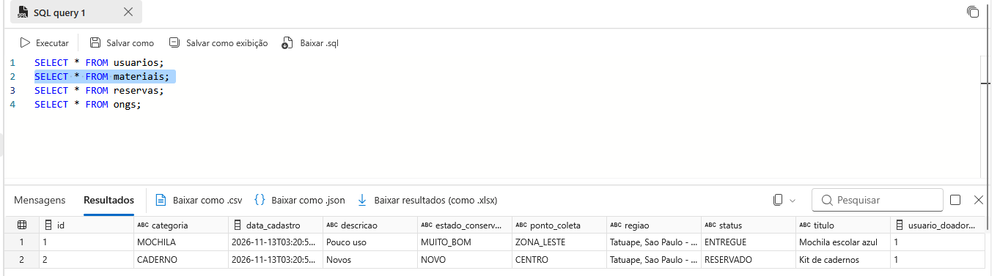
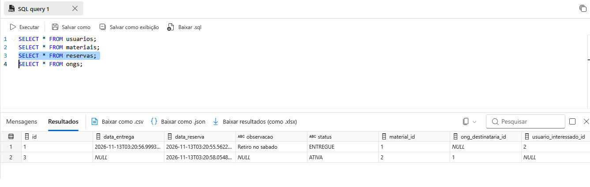
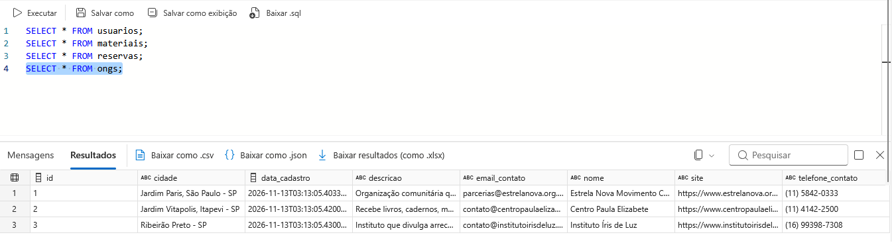

# ConectaDoa API

> **Links da entrega**
>
> | Evidência | Link |
> |---|---|
> | GitHub público | `https://github.com/lucascsalles/conectadoa-api` |
> | API no Azure (Swagger em `/`) | `https://conectadoa-api-554789.icyhill-bd77f9f6.brazilsouth.azurecontainerapps.io/` |
> | Docker Hub | `https://hub.docker.com/r/lucascsalles/conectadoa-api` |
> | GitHub Actions | aba **Actions** → workflow **Continuous Delivery** |
> | Evidências (prints) | [seção 9](#9-evidências-de-funcionamento) e pasta `docs/evidencias/` |

---

## 1. Objetivo da solução

O **ConectaDoa** conecta pessoas que têm **materiais escolares em bom estado** (mochilas, cadernos, livros, estojos) a **pessoas e ONGs** que precisam deles. O objetivo é reduzir o desperdício e facilitar o acesso a materiais de estudo, dentro do tema CitizenTech.

Fluxo principal:

1. Um usuário cadastra um material para doar.
2. O material aparece na lista como `DISPONIVEL`.
3. Outra pessoa reserva o material, que passa para `RESERVADO`. O próprio doador também pode destiná-lo a uma ONG.
4. O doador confirma a entrega, e o material passa para `ENTREGUE`.

As tecnologias são Java 21, Spring Boot, Spring Data JPA, Microsoft SQL Server, ModelMapper, springdoc-openapi (Swagger), Docker, GitHub Actions, Docker Hub e Azure Container Apps.

---

## 2. Mapa dos critérios de avaliação

Esta tabela indica onde cada item do enunciado está no projeto. Os caminhos partem de `src/main/java/br/com/conectadoa/`.

### 3.4.1 Entity e Modelagem de Dados

| Item | Onde |
|---|---|
| 4 entidades coerentes com o tema | `entity/Usuario.java`, `entity/Ong.java`, `entity/Material.java`, `entity/Reserva.java` |
| Pelo menos 5 atributos por entidade | Ver a tabela abaixo: Usuario tem 6, Ong 8, Material 10 e Reserva 8 |
| Pelo menos 2 obrigatórios por entidade | `@Column(nullable = false)` nas entidades, mais `@NotBlank`/`@NotNull` nos DTOs de request |
| Tabelas no plural | `@Table(name = "usuarios")`, `"ongs"`, `"materiais"`, `"reservas"` |
| Relacionamentos | `Material` → `Usuario` (`@ManyToOne`, doador); `Reserva` → `Material`, `Usuario` e `Ong` (`@ManyToOne`) |

| Entidade (tabela) | Atributos | Obrigatórios |
|---|---|---|
| Usuario (`usuarios`) | id, nome, email, telefone, regiao, dataCadastro | nome, email, telefone, regiao, dataCadastro |
| Ong (`ongs`) | id, nome, descricao, emailContato, telefoneContato, cidade, site, dataCadastro | nome, descricao, emailContato, telefoneContato, cidade, dataCadastro |
| Material (`materiais`) | id, titulo, descricao, categoria, estadoConservacao, regiao, pontoColeta, status, dataCadastro, usuarioDoador | todos, exceto id |
| Reserva (`reservas`) | id, material, usuarioInteressado, ongDestinataria, status, dataReserva, dataEntrega, observacao | material, status, dataReserva |

### 3.4.2 DTO e Mapeamento de Dados

| Item | Onde |
|---|---|
| DTOs de request | `dto/UsuarioRequest`, `dto/OngRequest`, `dto/MaterialRequest`, `dto/ReservaCreateRequest`, `dto/ReservaUpdateRequest` |
| DTOs de response | `dto/UsuarioResponse`, `dto/OngResponse`, `dto/MaterialResponse`, `dto/ReservaResponse` |
| ModelMapper | `dto/UsuarioMapper`, `dto/OngMapper`, `dto/MaterialMapper`, `dto/ReservaMapper`, com o método `modelMapper.map(...)`. A dependência `org.modelmapper` está no `pom.xml` |
| Separação Entity / Request / Response | As Controllers recebem `*Request` e devolvem `*Response`. Nenhuma entidade é exposta nas requisições ou respostas |

### 3.4.3 Controllers, CRUD e respostas HTTP

| Item | Onde |
|---|---|
| Uma Controller por entidade | `controller/UsuarioController`, `OngController`, `MaterialController`, `ReservaController` |
| CRUD completo | Cada Controller tem `POST`, `GET`, `GET /{id}`, `PUT /{id}` e `DELETE /{id}` |
| Respostas de sucesso | `201 Created` (POST), `200 OK` (GET/PUT), `204 No Content` (DELETE) |
| Erros de requisição e recursos inexistentes | `exception/ApiExceptionHandler.java`: `400` para dados inválidos, JSON mal formatado, tipo inválido ou header ausente; `404` para recurso ou rota inexistente |
| Corpo de erro padronizado, sem detalhes internos | `ApiExceptionHandler` sempre devolve `{timestamp, status, error, message}`. Falhas inesperadas viram `500` com mensagem genérica, sem stack trace |
| Controllers não acessam Repository | As Controllers injetam apenas a Service e o Mapper (`@Autowired`) |

O formato do corpo de erro é este:

```json
{ "timestamp": "2026-11-10T10:00:00", "status": 404, "error": "Not Found", "message": "Material 99 não encontrado." }
```

Além dos códigos esperados, a API usa dois outros de forma consistente:

- **`403 Forbidden`** quando o usuário informado não tem permissão para a ação, por exemplo quem não é o doador tentando editar o material.
- **`409 Conflict`** quando a requisição conflita com uma regra de negócio, por exemplo reservar um material que já está reservado, ou com um registro duplicado ou vinculado, como um e-mail repetido ou a exclusão de um usuário que ainda tem materiais.

### 3.4.4 Arquitetura em Camadas e Persistência

| Item | Onde |
|---|---|
| Service com regras de negócio | `service/*Service.java`, principalmente `ReservaService` e `MaterialService` (regras na seção 5) |
| Repository para SQL Server | `repository/*Repository.java`, que estendem `JpaRepository`; driver `mssql-jdbc` |
| Separação de camadas | Pacotes `controller`, `service`, `repository`, `entity` e `dto` |

### 3.4.5 Versionamento da API

Todas as Controllers usam `@RequestMapping("api/${api.version}/...")`, com `api.version=v1` em `application.properties`. Por isso, todas as rotas começam com `/api/v1/`.

### 3.4.6 OpenAPI/Swagger

| Item | Onde |
|---|---|
| Configuração | Dependência `springdoc-openapi-starter-webmvc-ui` no `pom.xml` |
| Documentação a partir de `/` | `springdoc.swagger-ui.path=/` em `application.properties`. A rota `/` abre o Swagger UI |
| Endpoints documentados | `@Tag` em cada Controller e `@Operation(summary = ...)` em cada endpoint. A especificação fica em `/v3/api-docs` |

### 3.2 Docker Hub e 3.3 GitHub Actions

| Item | Onde |
|---|---|
| Dockerfile | `Dockerfile`, com build multi-stage: Maven com Java 21, depois JRE 21 |
| Workflow automático após push na `main` | `.github/workflows/continuous_delivery.yml` (`on: push: branches: [main]`) |
| Build da aplicação e da imagem | `docker/build-push-action` executa o Dockerfile, que roda `mvn clean package` |
| Autenticação e publicação | `docker/login-action` com `vars.DOCKER_USER` e `secrets.DOCKER_TOKEN`; push das tags `latest`, `v<run>` e `<commit>` |
| Evidência | Histórico da aba **Actions** do repositório e prints na [seção 9](#9-evidências-de-funcionamento) |

### 3.1 Azure e SQL Server

A aplicação roda em **Azure Container Apps**, com a imagem vinda do Docker Hub, e usa um **Azure SQL Database**. O profile `prd` lê a conexão de variáveis de ambiente, e a senha é um secret do Container App. O passo a passo completo está em [`DEPLOY_AZURE.md`](DEPLOY_AZURE.md). As evidências de funcionamento e de persistência estão na [seção 9](#9-evidências-de-funcionamento).

---

## 3. Executar o Spring Boot localmente

Pré-requisitos: Java 21 e Docker.

### 3.1 SQL Server (configuração e execução)

**1. Subir o SQL Server em Docker.** A senha precisa ter pelo menos 8 caracteres, com letra maiúscula, letra minúscula, número e símbolo (exemplo: `Conecta@Doa2026`). Com senha fraca, o container para logo depois de iniciar.

```bash
docker run -d --name sqlserver -e "ACCEPT_EULA=Y" -e "MSSQL_SA_PASSWORD=<SENHA_FORTE>" -p 1433:1433 mcr.microsoft.com/mssql/server:2022-latest
```

**2. Esperar o SQL Server ficar pronto.** Na primeira vez leva de 30 a 60 segundos. Repita o comando até aparecer `SQL Server is now ready for client connections`. Antes disso, o login retorna `Login failed for user 'sa'`.

```bash
docker logs sqlserver 2>&1 | grep "ready for client"
```

**3. Criar o banco `conectadoa`.** Basta fazer uma vez:

```bash
docker exec sqlserver /opt/mssql-tools18/bin/sqlcmd -S localhost -U sa -P "<SENHA_FORTE>" -C -Q "CREATE DATABASE conectadoa"
```

> **Git Bash (Windows):** comece os comandos `docker exec` com `MSYS_NO_PATHCONV=1`, por exemplo `MSYS_NO_PATHCONV=1 docker exec sqlserver /opt/mssql-tools18/bin/sqlcmd ...`. Sem isso, o Git Bash altera o caminho `/opt/...` e o comando falha.

As tabelas são criadas automaticamente pelo Hibernate (`ddl-auto=update`). As 3 ONGs iniciais são inseridas pelo `src/main/resources/data.sql`, sem duplicar nas próximas execuções.

### 3.2 Aplicação (profile `dev`)

A senha do banco não fica no repositório: a aplicação a lê da variável de ambiente `DB_PWD`, que deve ter a mesma senha usada no container.

No PowerShell:

```powershell
$env:DB_PWD="<SENHA_FORTE>"
.\mvnw spring-boot:run "-Dspring-boot.run.profiles=dev"
```

No Linux, macOS ou Git Bash:

```bash
export DB_PWD='<SENHA_FORTE>'
./mvnw spring-boot:run -Dspring-boot.run.profiles=dev
```

Na primeira execução, o Maven Wrapper baixa as dependências, o que leva alguns minutos. A aplicação está no ar quando aparecer `Started ConectaDoaApplication`. Abra **http://localhost:8080/** para ver o Swagger.

### 3.3 Profiles e variáveis

| Profile | Arquivo | Banco |
|---|---|---|
| `dev` | `application-dev.properties` | SQL Server local (`localhost:1433`, banco `conectadoa`, usuário `sa`, senha `DB_PWD`) |
| `prd` | `application-prd.properties` | Variáveis `DB_SERVER_URL`, `DB_SERVER_PORT`, `DB_SCHEMA`, `DB_USER` e `DB_PWD`, usadas no Docker e no Azure |

---

## 4. Docker Hub, workflow e Azure

**Imagem no Docker Hub:** `lucascsalles/conectadoa-api`, com as tags `latest`, `v<número do build>` e `<sha do commit>`.

Para baixar e rodar a imagem:

```bash
docker pull lucascsalles/conectadoa-api:latest

docker run -p 8080:8080 \
  -e DB_SERVER_URL=<host> -e DB_SERVER_PORT=1433 -e DB_SCHEMA=conectadoa \
  -e DB_USER=<usuario> -e DB_PWD=<senha> \
  lucascsalles/conectadoa-api:latest
```

**Workflow:** `.github/workflows/continuous_delivery.yml` roda a cada push na `main`. Ele faz o build da aplicação, o build da imagem, o login no Docker Hub e o push. A configuração fica em *Settings → Secrets and variables → Actions*:

- Variable `DOCKER_USER`: usuário do Docker Hub.
- Secret `DOCKER_TOKEN`: access token do Docker Hub.

**URL no Azure:** `https://conectadoa-api-554789.icyhill-bd77f9f6.brazilsouth.azurecontainerapps.io/` (Swagger em `/`).

---

## 5. Regras de negócio (camada Service)

1. Todo material começa `DISPONIVEL` e pertence a quem o cadastrou (o doador).
2. Só materiais `DISPONIVEL` podem ser reservados. Ao reservar, o material passa para `RESERVADO`. Uma segunda reserva retorna **409**.
3. O doador não pode reservar o próprio material para si (**409**). Ele pode destiná-lo a uma ONG enviando `ongDestinatariaId`. Quem não é o doador e tenta fazer isso recebe **403**.
4. Toda reserva tem exatamente um destinatário: a pessoa que reservou **ou** a ONG escolhida pelo doador.
5. Só o doador edita ou exclui o material (**403** para os demais). A exclusão só é permitida enquanto o material está `DISPONIVEL` (**409** caso contrário).
6. Só o doador confirma a entrega: `PUT /reservas/{id}` com `"status": "ENTREGUE"`. O material passa para `ENTREGUE`.
7. Cancelar a reserva (`DELETE /reservas/{id}`) devolve o material para `DISPONIVEL`. Uma reserva já entregue não pode ser cancelada (**409**).

**Header `X-Usuario-Id`:** o MVP não tem login. Nas rotas de **materiais** (POST, PUT, DELETE) e de **reservas** (POST, PUT, DELETE), o ID do usuário que executa a ação vai no header `X-Usuario-Id`. No Swagger, esse campo aparece como parâmetro obrigatório.

---

## 6. Como testar a solução

A forma mais simples é pelo **Swagger** (`/`), local ou no Azure: abra a rota, clique em **Try it out**, preencha os campos (inclusive o header `X-Usuario-Id`, quando ele aparecer) e clique em **Execute**.

A sequência abaixo faz o mesmo com `curl` no Bash, Linux, macOS ou Git Bash. Ela cobre o CRUD das 4 entidades e os códigos HTTP esperados. Defina antes:

```bash
BASE=http://localhost:8080/api/v1   # ou https://conectadoa-api-554789.icyhill-bd77f9f6.brazilsouth.azurecontainerapps.io/api/v1
```

Observações:

- **IDs:** os exemplos supõem um banco novo, que só tem as 3 ONGs iniciais. Se não for o caso, use os IDs retornados nas respostas.
- **Acentos:** os textos dos exemplos estão sem acento de propósito. No Windows, o `curl` do Git Bash não envia acentos em UTF-8, e a API responderia `400`. Pelo Swagger, os acentos funcionam normalmente.
- **PowerShell:** use o Git Bash para estes comandos. No PowerShell, `curl` é um apelido de outro comando e as aspas do JSON se comportam de outro jeito.

### Usuários

```bash
# 201: cria a doadora (id 1) e o interessado (id 2)
curl -i -X POST $BASE/usuarios -H "Content-Type: application/json" -d '{"nome":"Ana Souza","email":"ana@example.com","telefone":"11988887777","regiao":"Tatuape, Sao Paulo - SP"}'
curl -i -X POST $BASE/usuarios -H "Content-Type: application/json" -d '{"nome":"Bruno Lima","email":"bruno@example.com","telefone":"11977776666","regiao":"Mooca, Sao Paulo - SP"}'

curl -i $BASE/usuarios                     # 200: lista
curl -i $BASE/usuarios/1                   # 200: consulta
curl -i $BASE/usuarios/9999                # 404: inexistente

# 200: atualiza
curl -i -X PUT $BASE/usuarios/2 -H "Content-Type: application/json" -d '{"nome":"Bruno Lima","email":"bruno@example.com","telefone":"11977776666","regiao":"Centro, Sao Paulo - SP"}'

# 400: dados inválidos
curl -i -X POST $BASE/usuarios -H "Content-Type: application/json" -d '{"nome":"","email":"invalido"}'
```

### ONGs

As três ONGs iniciais já vêm cadastradas pelo `data.sql`.

```bash
curl -i $BASE/ongs                         # 200: lista
curl -i $BASE/ongs/1                       # 200: consulta

# 201: cria (id 4)
curl -i -X POST $BASE/ongs -H "Content-Type: application/json" -d '{"nome":"ONG Teste","descricao":"Recebe materiais escolares","emailContato":"teste@ong.org","telefoneContato":"1130000000","cidade":"Sao Paulo - SP"}'

# 200: atualiza
curl -i -X PUT $BASE/ongs/4 -H "Content-Type: application/json" -d '{"nome":"ONG Teste 2","descricao":"Recebe materiais escolares","emailContato":"teste@ong.org","telefoneContato":"1130000000","cidade":"Sao Paulo - SP"}'

curl -i -X DELETE $BASE/ongs/4             # 204: exclui
```

### Materiais

```bash
# 201: Ana (1) cadastra o material (id 1, status DISPONIVEL)
curl -i -X POST $BASE/materiais -H "Content-Type: application/json" -H "X-Usuario-Id: 1" -d '{"titulo":"Mochila escolar","descricao":"Pouco uso","categoria":"MOCHILA","estadoConservacao":"MUITO_BOM","regiao":"Tatuape, Sao Paulo - SP","pontoColeta":"ZONA_LESTE"}'

curl -i "$BASE/materiais?categoria=MOCHILA"   # 200: lista com filtro
curl -i $BASE/materiais/1                     # 200: consulta

# 200: atualiza (doadora)
curl -i -X PUT $BASE/materiais/1 -H "Content-Type: application/json" -H "X-Usuario-Id: 1" -d '{"titulo":"Mochila escolar azul","descricao":"Pouco uso","categoria":"MOCHILA","estadoConservacao":"MUITO_BOM","regiao":"Tatuape, Sao Paulo - SP","pontoColeta":"ZONA_LESTE"}'

# 403: Bruno não é o doador
curl -i -X PUT $BASE/materiais/1 -H "Content-Type: application/json" -H "X-Usuario-Id: 2" -d '{"titulo":"x","descricao":"x","categoria":"MOCHILA","estadoConservacao":"BOM","regiao":"x","pontoColeta":"CENTRO"}'
```

### Reservas

```bash
# 201: Bruno (2) reserva o material 1 (reserva id 1); o material vira RESERVADO
curl -i -X POST $BASE/reservas -H "Content-Type: application/json" -H "X-Usuario-Id: 2" -d '{"materialId":1,"observacao":"Retiro no sabado"}'

# 409: o material já está reservado
curl -i -X POST $BASE/reservas -H "Content-Type: application/json" -H "X-Usuario-Id: 2" -d '{"materialId":1}'

curl -i "$BASE/reservas?usuarioInteressadoId=2"   # 200: reservas do Bruno
curl -i $BASE/reservas/1                          # 200: consulta

# 200: Ana confirma a entrega; o material vira ENTREGUE
curl -i -X PUT $BASE/reservas/1 -H "Content-Type: application/json" -H "X-Usuario-Id: 1" -d '{"status":"ENTREGUE"}'

# 204: exclusão (cancelamento) de uma reserva ativa
# Ana cadastra outro material (id 2), Bruno reserva (reserva id 2) e depois cancela; o material volta a DISPONIVEL
curl -i -X POST $BASE/materiais -H "Content-Type: application/json" -H "X-Usuario-Id: 1" -d '{"titulo":"Kit de cadernos","descricao":"Novos","categoria":"CADERNO","estadoConservacao":"NOVO","regiao":"Tatuape, Sao Paulo - SP","pontoColeta":"CENTRO"}'
curl -i -X POST $BASE/reservas -H "Content-Type: application/json" -H "X-Usuario-Id: 2" -d '{"materialId":2}'
curl -i -X DELETE $BASE/reservas/2 -H "X-Usuario-Id: 2"

# 201: Ana destina o material 2 à ONG 1
curl -i -X POST $BASE/reservas -H "Content-Type: application/json" -H "X-Usuario-Id: 1" -d '{"materialId":2,"ongDestinatariaId":1}'
```

### Exclusões e conflitos

```bash
# 204: material disponível excluído pelo doador
curl -i -X POST $BASE/materiais -H "Content-Type: application/json" -H "X-Usuario-Id: 1" -d '{"titulo":"Estojo","descricao":"Bom estado","categoria":"ESTOJO","estadoConservacao":"BOM","regiao":"Tatuape, Sao Paulo - SP","pontoColeta":"ZONA_SUL"}'
curl -i -X DELETE $BASE/materiais/3 -H "X-Usuario-Id: 1"

# 204: usuário sem vínculos
curl -i -X POST $BASE/usuarios -H "Content-Type: application/json" -d '{"nome":"Carla","email":"carla@example.com","telefone":"11966665555","regiao":"Centro, Sao Paulo - SP"}'
curl -i -X DELETE $BASE/usuarios/3

# 409: Ana possui materiais vinculados
curl -i -X DELETE $BASE/usuarios/1
```

### Persistência no SQL Server

Depois dos testes, consulte o banco. Também dá para reiniciar a aplicação e repetir os `GET`: os dados continuam lá.

```sql
SELECT * FROM usuarios;
SELECT * FROM ongs;
SELECT * FROM materiais;
SELECT * FROM reservas;
```

---

## 7. Valores aceitos (enums)

| Campo | Valores |
|---|---|
| `categoria` | `CADERNO`, `LIVRO`, `MOCHILA`, `ESTOJO`, `ESCRITA`, `ARTE`, `OUTROS` |
| `estadoConservacao` | `NOVO`, `MUITO_BOM`, `BOM` |
| `pontoColeta` | `CENTRO`, `ZONA_SUL`, `ZONA_LESTE` (pontos ilustrativos do MVP) |
| `status` do material | `DISPONIVEL`, `RESERVADO`, `ENTREGUE` (controlado pelas reservas) |
| `status` da reserva | `ATIVA`, `ENTREGUE` |

---

## 8. ONGs pré-cadastradas (fontes públicas)

| ONG | Local | Fonte |
|---|---|---|
| Estrela Nova Movimento Comunitário | Jardim Paris, São Paulo - SP | https://www.estrelanova.org.br/https-estrelanovadoe-paradoar-org/ |
| Centro Paula Elizabete | Itapevi - SP | https://www.centropaulaelizabete.org.br/materiais-escolares |
| Instituto Íris de Luz | Ribeirão Preto - SP | https://www.institutoirisdeluz.ong.br/materialescolar |

As condições de recebimento devem ser confirmadas diretamente com cada organização.

---

## 9. Evidências de funcionamento

Os prints abaixo foram tirados em 13/11/2026, com a API implantada no Azure. Os arquivos ficam em `docs/evidencias/`.

### 9.1 GitHub Actions: workflow executado após push na `main`

O workflow **Continuous Delivery** rodou automaticamente após o push e terminou com sucesso: compilou a aplicação, gerou a imagem e publicou no Docker Hub.



### 9.2 Docker Hub: imagem publicada com tags

O repositório `lucascsalles/conectadoa-api` tem as tags `latest`, `v1` e `e8eaa3d` (o commit).



### 9.3 Azure Container Apps: aplicação em execução

O Container App `conectadoa-api-554789` está com status "Em execução" na região Brazil South, com URL pública.



### 9.4 Swagger acessível a partir da URL do Azure

A rota `/` redireciona para o Swagger UI, com os endpoints `/api/v1/...` documentados.



### 9.5 Testes das rotas e respostas HTTP no Azure

O roteiro da [seção 6](#6-como-testar-a-solução) foi executado contra a URL do Azure. As 31 chamadas retornaram o código esperado: 201, 200, 204, 400, 403, 404 e 409.



### 9.6 Persistência no SQL Server (Azure SQL Database)

Os dados criados pelos testes foram consultados no banco `conectadoa`, pelo Query editor do portal do Azure. Eles mostram:

- **Usuários:** Ana e Bruno. A Carla foi excluída no teste.
- **Materiais:** a mochila com status `ENTREGUE` e os cadernos com status `RESERVADO`.
- **Reservas:**
  - uma reserva de pessoa, já entregue e com data de entrega;
  - uma destinação para a ONG 1.
  - A reserva 2 foi cancelada no teste, por isso não aparece.
- **ONGs:** as 3 ONGs iniciais, inseridas pelo `data.sql`, com acentuação correta.









Depois dos prints, o banco do Azure foi limpo e voltou a ter só as 3 ONGs iniciais. Assim, o roteiro da seção 6 pode ser executado novamente com os mesmos IDs.

